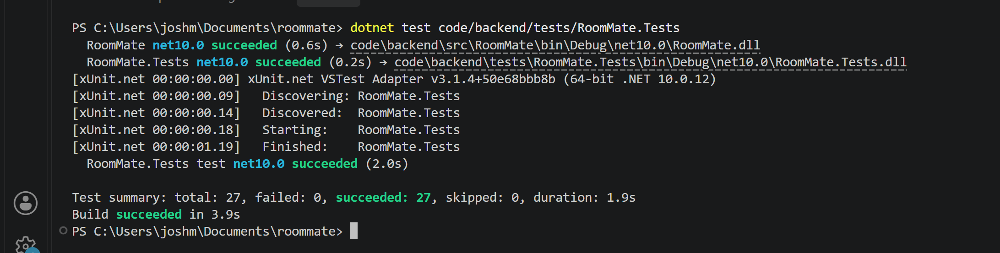

# Sprint 2 Report
Video Link: [FINAL UNLISTED YOUTUBE LINK]

## What's New (User Facing)
* User registration with email and password
* Login and logout
* Create, view, and edit your own roommate profile on the website
* Find Roommates page showing students ranked by compatibility score
* Minimum compatibility score filter

## Work Summary (Developer Facing)
During Sprint 2, we connected the backend features from Sprint 1 to a working ASP.NET Core Razor Pages application. We replaced TempUser with a real User class, added password hashing and cookie authentication, and built profile pages backed by SQLite through Entity Framework Core. We added a search method that scores other students with the Sprint 1 compatibility method and returns them ranked, along with a search page and score filter. Work was done on feature branches and combined on `integration/sprint2`.

## Design Decisions
- Passwords are hashed with ASP.NET Core's PasswordHasher so plain text is never stored.
- Cookie authentication keeps users logged in, and the logged-in user's ID comes from the cookie rather than from the URL.
- Smoking dealbreakers (a score of 0) are left out of search results rather than shown at 0%.
- Students with incomplete profiles are skipped because they can't be scored.
- Scores are rounded to one decimal place, and ties are ordered by UserId so results stay in a consistent order.
- The filter is read from the URL (`?MinScore=70`). The page clamps out-of-range values, while the method itself rejects them.
- Sample students are seeded only in Development so that search can be demonstrated.

## Testing
- Unit tests are written with xUnit. There are 27 test cases. All passed on `integration/sprint2` on November 3, 2026.
- New in Sprint 2: 8 search test cases (`SearchTests.cs`) and 3 authentication tests (`AuthTests.cs`).
- Evidence: 

## Unfinished Work
FR-06 through FR-10 (roommate requests, notifications, accepting or declining, pairing, and the admin view) were not implemented and move to Sprint 3. FR-01 through FR-05 are complete, which is 5 of 10 functional requirements.

## Completed Issues/User Stories
- #5 User Registration
- #1 User Login
- #13 Implement User Model
- #14 Connect Profile Features to Website
- #15 Implement Roommate Search
- #22 Minimum Compatibility Score Filter
- #23 Roommate Search Tests
- #18 Implement Password Hashing
- #19 Implement User Logout
- #20 Connect User Authentication to Profiles
- #21 Update Home Page and Navigation Bar

## Incomplete Issues/User Stories
- No Sprint 2 issues are incomplete. FR-06 through FR-10 have not been started and move to Sprint 3.

## Team Contributions
- Minsu: profile pages, registration, login, User class, authentication tests, integration, and presentation slides.
- Joshua: roommate search, score filter, search page, sample data, and search tests.
- Stockton: Registration and login were assigned to Stockton in Sprint 1 and were completed by Minsu in Sprint 2. As of November 5, the repository history shows no commits under this name.

## Code Files for Review
Please review the following code files, which were actively developed during this sprint, for quality:
* [Profile.SearchRoommates.cs](https://github.com/Minsu-Kim3/roommate/blob/main/code/backend/src/RoomMate/Models/Profile.SearchRoommates.cs)
* [SearchTests.cs](https://github.com/Minsu-Kim3/roommate/blob/main/code/backend/tests/RoomMate.Tests/SearchTests.cs)
* [Register.cshtml.cs](https://github.com/Minsu-Kim3/roommate/blob/main/code/backend/src/RoomMate/Pages/Account/Register.cshtml.cs)
* [Login.cshtml.cs](https://github.com/Minsu-Kim3/roommate/blob/main/code/backend/src/RoomMate/Pages/Account/Login.cshtml.cs)
* [AuthTests.cs](https://github.com/Minsu-Kim3/roommate/blob/main/code/backend/tests/RoomMate.Tests/AuthTests.cs)

## Retrospective Summary
# Here's what went well:
* Delivered a working web application with login, profiles, and search.
* Finished the registration and login work carried over from Sprint 1.
* Expanded the test suite, including tests for the new features.
# Here's what we'd like to improve:
* Workload distribution and early follow-up on assigned work.
* Integrating sooner than the last days of the sprint.
* Updating the Kanban board and capturing screenshots on schedule.
# Here are changes we plan to implement in the next sprint:
* Merge features to `main` at least 3 days before the deadline.
* Set a mid-sprint check-in, and reassign any item with no pushed work by then.
* Assign one person to capture the Kanban board at the start, midpoint, and end of the sprint.
