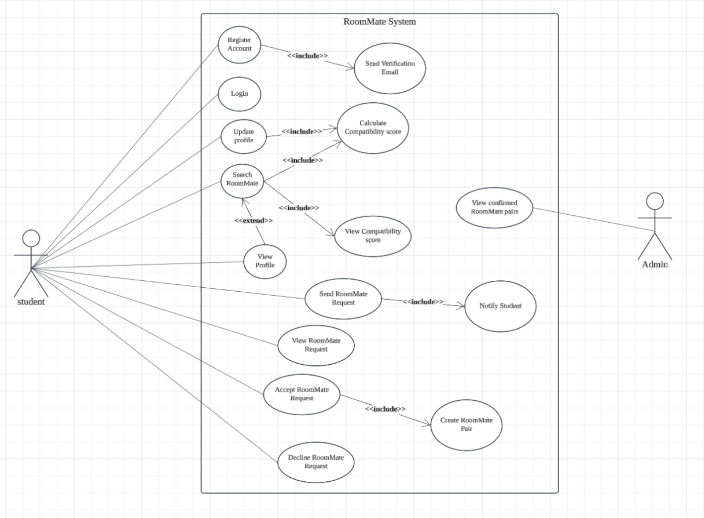
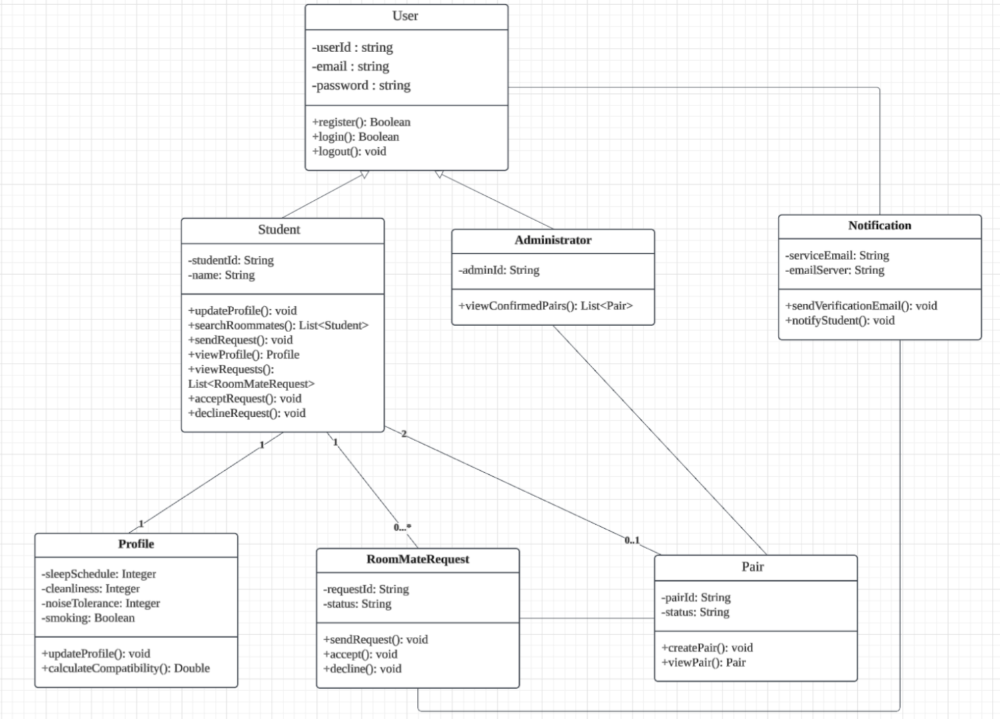
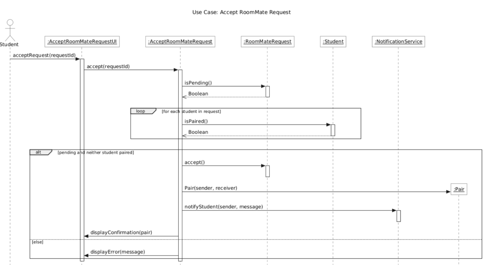
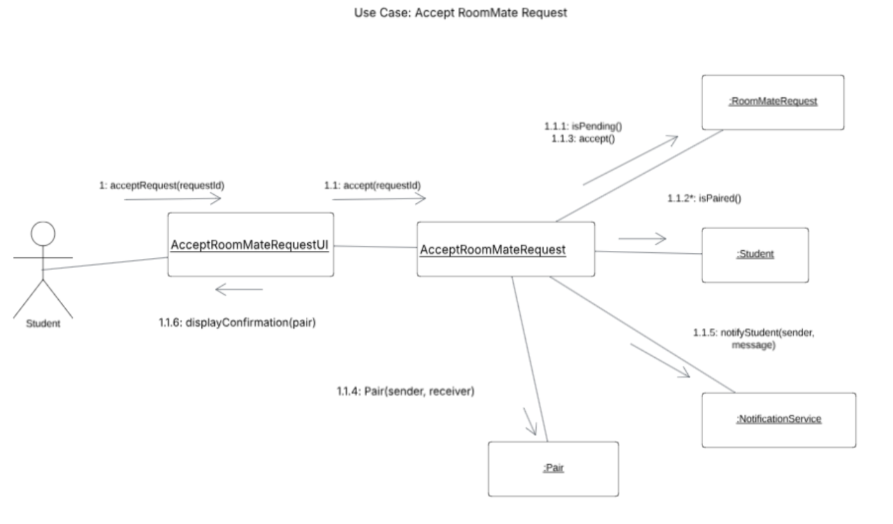

# RoomMate Design

## Architecture
A web app that is built using ASP.NET Core Razor Pages in C# on .NET 10.
Data is stored in SQLite through Entity Framework Core.
Team chose a web app because students can use it on any browser and we chose SQLite because it is a single file and needs no server setup.

## Use Case Diagram
Two main actors: Student and Admin
Student: can register, log in, update profile, search and send, view, accept, and decline requests.
Admin: can view confirmed pairs.
Key realtionships: update profile and search include calculating the compatibility score and accepting a request includes creating a pair.

## Class Diagram
Student and Administrator inherit from User
Each student has one Profile
A student can send multiple RoomMateRequests
Two students per pair

## Accept RoomMate Request: Sequence Diagram
To accept a roommate request it checks if it’s pending, checks that neither student is already paired, creates a Pair, notifys the sender. Otherwise, show an error.
Planned for a later sprint.

## Accept RoomMate Request: Communication Diagram
Same as above: To accept a roommate request it checks if it’s pending, checks that neither student is already paired, creates a Pair, notifys the sender. Otherwise, show an error.
Planned for a later sprint.

## Differences Between Diagram and Code
Smoking was split into IsSmoker and OkWithSmoker because before we had one boolean to represent that value and that cant represent “I don’t smoke, but I’m fine living with a smoker.”
Temp user was added.
IDs are int instead of string because it is more intuitve.

## Compatibility Score Design
Calculation compatibility soce uses three ratings from 1 to 5: sleep schedule, cleanliness, and noise tolerance.
we compair the compatibility rating scores and when identical we use 1.0 and 0.0 when 4 apart. Then the three are averaged and multiplied by 100.
If smoking-incompatible score is automatically 0 .
If profile is incomplete it displays an error.