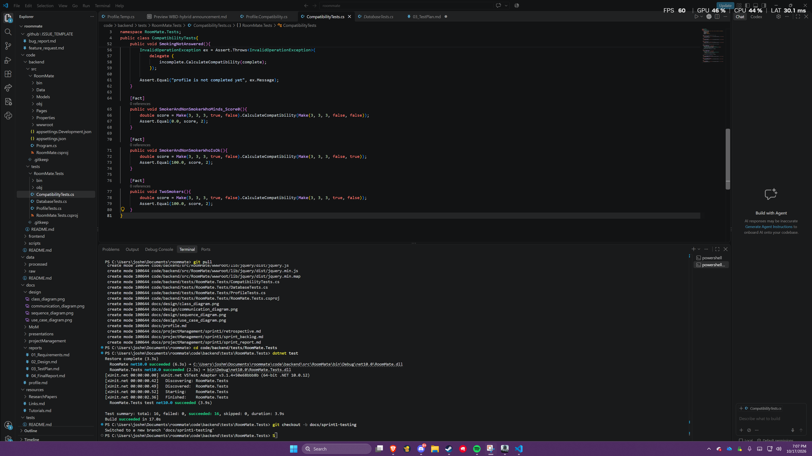

# RoomMate Test Plan

## Scope
Sprint 1 covered: profile creation and validation, retrieval by user ID, SQLite save and load, and the compatibility score.
In Sprint 2 we will implement login, registration, and the UI.

Tests to be implemented in Sprint 2:
- Login and registration
- The web pages / UI

## Approach
- Framework: xUnit
- Database tests use a temporary in-memory SQLite database
- How to run:

```
cd code/backend/tests/RoomMate.Tests
dotnet test
```

## Compatibility Score Tests (CompatibilityTests.cs)
- profile_Score100: identical ratings so expected score of 100
- profile_Score0: ratings 4 apart on everything resulting in a score of 0
- MixedProfiles: partly matching profiles so score of 75
- MissingRating: throws "profile is not completed yet"
- SmokingNotAnswered: throws "profile is not completed yet"
- SmokerAndNonSmokerWhoMinds_Score0: fails the smoking filter so returns 0 immediately
- SmokerAndNonSmokerWhoIsOk: passes the smoking filter and ratings are identical so gives 100
- TwoSmokers: same as above but both smoke, gives 100

## Profile Tests (ProfileTests.cs)
- CreateProfile_Valid: creates profile
- CreateProfile_InvalidRating: rating outside 1 to 5 causes an error
- CreateProfile_SmokingNotAnswered: missing smoking answer causes an error
- CreateProfile_DuplicateUserId: a second profile for the same user causes an error
- GetProfileByUserId_Exists: an existing ID returns the profile
- GetProfileByUserId_NotFound: a missing ID returns null

## Database Tests (DatabaseTests.cs)
- CreateAndGetProfile: a saved profile loads back with the same values
- GetProfileByUserId_NotFound: searching an empty database returns null

## Results
All 16 tests pass.
